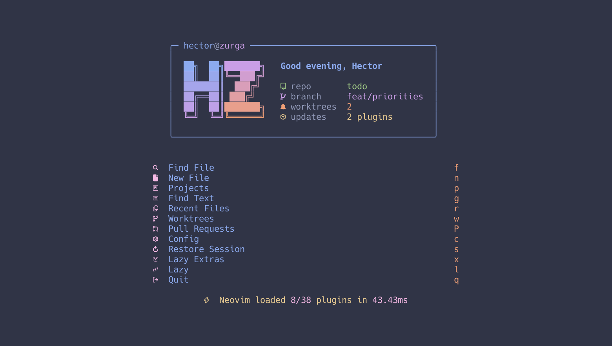
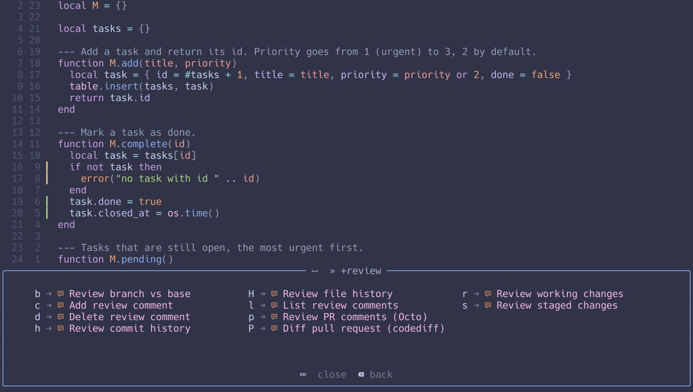
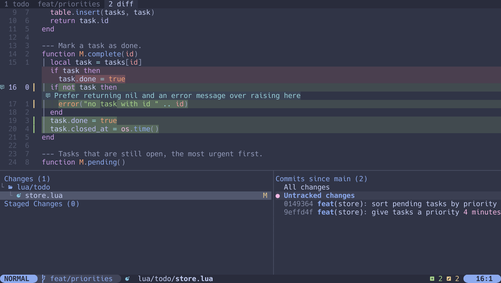
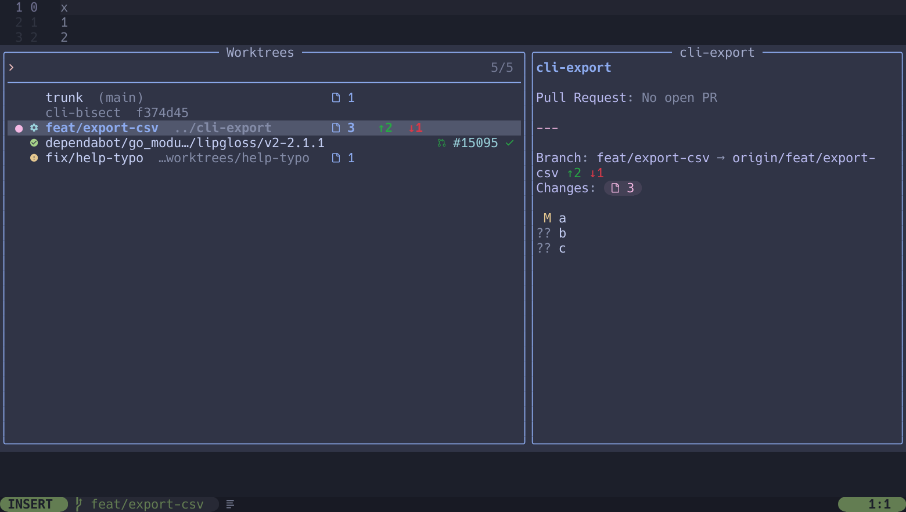
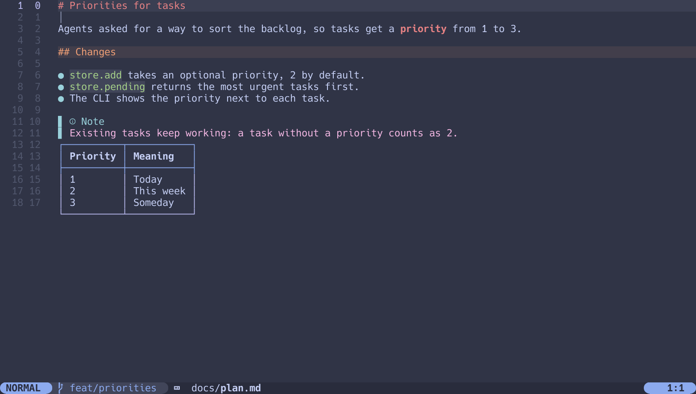
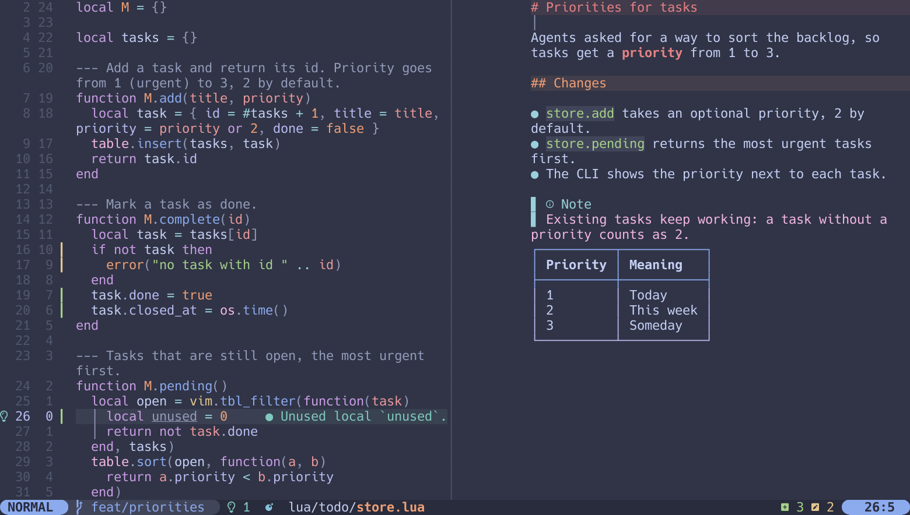

# Neovim Config Cheatsheet

Built on [LazyVim](https://lazyvim.github.io/). This file covers custom and frequently-used keymaps.
For the full LazyVim keymap reference: https://www.lazyvim.org/keymaps



---

## Setup

```sh
./install-deps.sh       # install system dependencies
```

Inside Neovim:

```
:checkhealth user       # verify all tools are healthy
:Lazy                   # plugin manager UI
:Lazy update            # update plugins + lazy-lock.json
:Mason                  # LSP / formatter / linter manager
```

---

## Leader Key

`<leader>` = **Space**

Run `:WhichKey <leader>` to interactively browse all leader bindings.



---

## Files & Navigation

| Key | Action |
|-----|--------|
| `<leader>e` | Toggle file explorer (snacks) |
| `<leader>ff` | Find files |
| `<leader>fr` | Recent files |
| `<leader>fb` | Browse buffers |
| `<S-h>` / `<S-l>` | Prev / next buffer |
| `<leader>bd` | Delete buffer |
| `<leader>bb` | Switch to other buffer |

---

## Search

| Key | Action |
|-----|--------|
| `<leader>sg` | Live grep (ripgrep) |
| `<leader>sw` | Search word under cursor |
| `<leader>s"` | Search registers |
| `<leader>sk` | Search keymaps |

---

## Code (LSP)

| Key | Action |
|-----|--------|
| `gd` | Go to definition |
| `gr` | References |
| `gI` | Go to implementation |
| `K` | Hover docs |
| `<leader>ca` | Code action |
| `<leader>cr` | Rename symbol |
| `<leader>cd` | Line diagnostics |
| `<leader>cf` | Format file |
| `]d` / `[d` | Next / prev diagnostic |

---

## Git

| Key | Action |
|-----|--------|
| `<leader>gg` | Open LazyGit (LazyVim default) |
| `<leader>gb` | Git blame line |
| `<leader>gd` | Git diff |
| `]h` / `[h` | Next / prev hunk |
| `<leader>ghs` | Stage hunk |
| `<leader>ghr` | Reset hunk |
| `<leader>gw` | **Worktrees panel** (see below) |
| `<leader>gW` | New worktree |
| `<leader>go` | Open the PR of the current branch in the browser |

---

## AI Tools

### Claude Code via herdr (`<leader>a`)

Needs nvim running inside [herdr](https://github.com/ogulcancelik/herdr). Each worktree gets a tab in nvim's herdr
workspace with Claude on the left and its own nvim on the right. If a prompt can't be delivered, it is kept in the
clipboard and in register `r`.

| Key | Action |
|-----|--------|
| `<leader>aa` | Open/focus Claude for this worktree |
| `<leader>az` | Hide or show the Claude chat next to nvim |
| `<leader>as` | Send pending review comments to Claude (stays in nvim) |
| `<leader>aS` | Re-send all open review comments |
| `<leader>aq` | Ask Claude about the line/selection (n, x) |
| `<leader>at` | Send the PR thread on this line (Octo review) |
| `<leader>aT` | Choose PR threads to send: `<Tab>` selects, `<CR>` sends (Octo review) |

---

## Code Review (`<leader>r`)

The diff shows each change inline with its review comments. Below it, the changed files sit next to the branch commits;
choosing a commit filters the files and the diff to it.



| Key | Action |
|-----|--------|
| `<leader>rr` | Review working changes (live-updates while the agent works) |
| `<leader>rb` | Review branch vs base (`main...`) |
| `<leader>rs` | Review staged changes |
| `<leader>rh` | Commit history |
| `<leader>rH` | History of current file |
| `<leader>rP` | Diff a pull request in codediff |
| `<leader>rc` | Add review comment on line/selection (n, x) |
| `<leader>rd` | Delete review comment on this line |
| `<leader>rl` | List comments (`<C-r>` resolve, `<C-x>` delete) |

Comments are stored outside the repo in `stdpath("cache")/review/<repo>/<worktree>/` and are deleted after
14 days without changes.

### Comments from other reviewers (octo.nvim)

| Key | Action |
|-----|--------|
| `<leader>rp` | Open a PR review by number (empty: PR of the current branch) |
| `<leader>as` | Send open threads not sent yet to Claude |
| `<leader>aS` | Send every open thread again |
| `<leader>at` / `<leader>aT` | Send this line's thread / choose threads |
| `<leader>aq` | Ask Claude about the selected diff lines |

Comments appear inline under their line, and a thread counts as new again when someone replies. The review opens
read-only (`:Octo review browse`), so nothing is published; run `:Octo review start` to write your own review.
Prompts go to the worktree that has the PR branch checked out, and you are asked first if there is none.

### Inside the diff view (codediff.nvim)

The bottom row has the changed files on the left and the commits of the branch on the right. Choosing a commit
filters the file list and the diff to it. `All changes` shows everything since the branch was created, committed or
not, and `Untracked changes` shows only the work not committed yet, including new files.

| Key | Action |
|-----|--------|
| `gf` | Open the file in the previous tab to edit it |
| `]c` / `[c` | Next / prev change |
| `]f` / `[f` | Next / prev file |
| `-` | Stage/unstage file |
| `<leader>hs` / `<leader>hu` / `<leader>hr` | Stage / unstage / discard hunk |
| `t` | Toggle inline (default) / side-by-side |
| `gc` | Toggle compact mode (fold unchanged code) |
| `<leader>b` / `<leader>e` | Toggle (with commits) / focus file list |
| `g?` | Show all diff keymaps |
| `q` | Close the diff tab |
| `<CR>` (commits) | Show that commit, `Untracked changes` or `All changes` |
| `R` (commits) | Refresh the commit list |
| `l` (files) / `h` (commits) | Jump between the file list and the commits |

---

## Worktrees

Inside herdr, each worktree has its own herdr tab (Claude and nvim). Outside herdr, each worktree is a tab of this nvim.
Use herdr to move around: `Ctrl-b h`/`l` between chat and nvim, `Ctrl-b z` to zoom a pane, `Ctrl-b b` for the sidebar.
Any worktree git knows about is listed: sibling folders, `.worktrees/`, `.claude/worktrees/`.



Each row shows, from left to right: `●` the worktree you are in (`○` one open in another tab), the Claude state in
herdr (working, waiting for you, done), the branch and its folder, uncommitted changes, commits ahead `↑` and
behind `↓` its upstream, and the PR with the result of its checks. The panel opens on the worktree you are in.
Below 120 columns the preview moves under the list, and it switches back when the terminal grows again.

| Key | Action |
|-----|--------|
| `<leader>gw` | Open the panel |
| `<CR>` (panel) | Go to the worktree's herdr tab, creating chat and nvim if needed |
| `<C-n>` (panel) | New worktree |
| `<C-x>` (panel) | Remove worktree and close its herdr tab |
| `<C-a>` (panel) | Go to the worktree's herdr tab, on the Claude chat |
| `gt` / `gT` | Next / prev tab |

Panel markers: `●` current, `○` open in a tab, file badge for uncommitted files, ` #N` open PR, `↑N`/`↓N` ahead/behind.
The PR number color shows its state: red for failed checks, conflicts or requested changes, yellow for running checks
or the merge queue, green when approved, gray for drafts. The right panel shows the PR status and link, then `git status`. PRs need `gh`.

The statusline shows the PR of the current branch with its status (`Open`, `Draft`, `Checks failed`, `Approved`,
`Queued`, `Merged`…). It refreshes in the background when you change tab or return to nvim, and every 2 minutes.

Agent state: `󰒓` working, `󰀨` waiting for you, `󰗠` done, `󰝦` idle, `󰋗` unknown.

---

## Writing

Markdown, text and git commit buffers get word wrap, Spanish + English spelling and grammar checks (ltex).



| Key | Action |
|-----|--------|
| `<leader>um` | Toggle rendered markdown |
| `<leader>uz` | Toggle zen mode |
| `<leader>us` | Toggle spelling |
| `<leader>cG` | Toggle grammar language (English by default, or Spanish) |
| `z=` | Spelling suggestions |
| `zg` | Add word to dictionary |

---

## Editor

Only the active window shows line numbers (absolute and relative) and the current line, and diagnostic messages
appear on the cursor line; other problems keep their sign in the margin.



| Key | Action |
|-----|--------|
| `<leader>o` | Add empty line below |
| `<leader>O` | Add empty line above |
| `<leader>ce` | Select all |
| `<S-CR>` (insert) | New line below (stay in insert mode) |
| `<C-CR>` (insert) | New line above (stay in insert mode) |
| `<A-j>` / `<A-k>` | Move line/selection down/up |
| `gc` / `gcc` | Comment selection / line |

---

## Window / Splits

| Key | Action |
|-----|--------|
| `<C-h/j/k/l>` | Navigate windows |
| `<leader>w\|` | Vertical split |
| `<leader>w-` | Horizontal split |
| `<leader>wd` | Close window |
| `<leader>ww` | Other window |

---

## UI Toggles

| Key | Action |
|-----|--------|
| `<leader>uf` | Toggle format on save |
| `<leader>un` | Dismiss notifications |
| `<leader>ul` | Toggle line numbers |
| `<leader>uw` | Toggle word wrap |
| `<leader>uT` | Toggle treesitter highlight |

---

## Plugin Conditional Loading

Plugins only load when their dependency is present:

| Plugin | Requires |
|--------|----------|
| LazyGit keymaps | `lazygit` executable |
| `<leader>a` agent keymaps | `herdr` + `claude` CLI |
| wakatime | `~/.wakatime.cfg` with `api_key` |
| gopls LSP | `go` executable |

---

## Disabled plugins

Requires Neovim 0.12+. These plugins are disabled in `lua/plugins/disabled.lua`:

| Disabled | Replaced by |
|----------|-------------|
| bufferline.nvim | Tabline with one tab per worktree |
| fzf-lua | snacks.picker |
